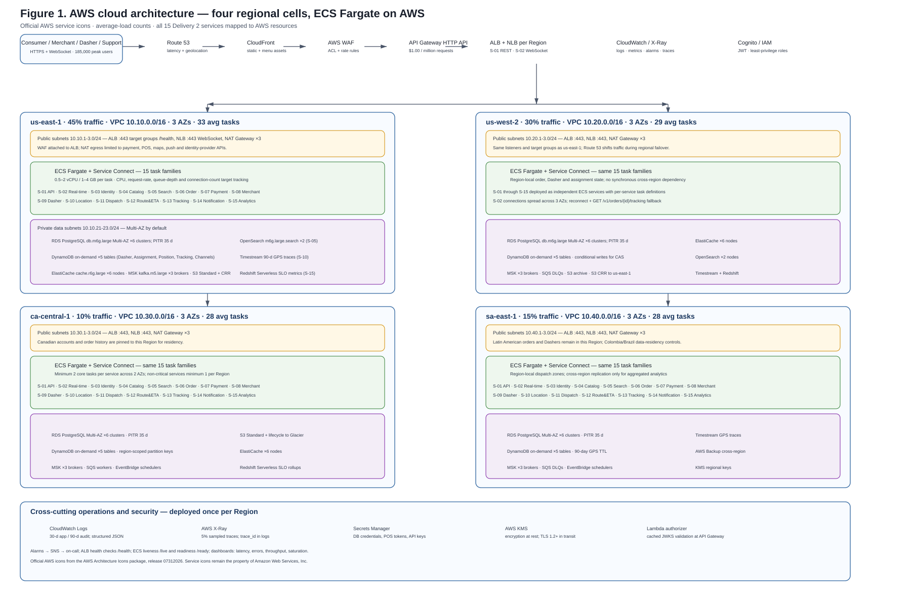
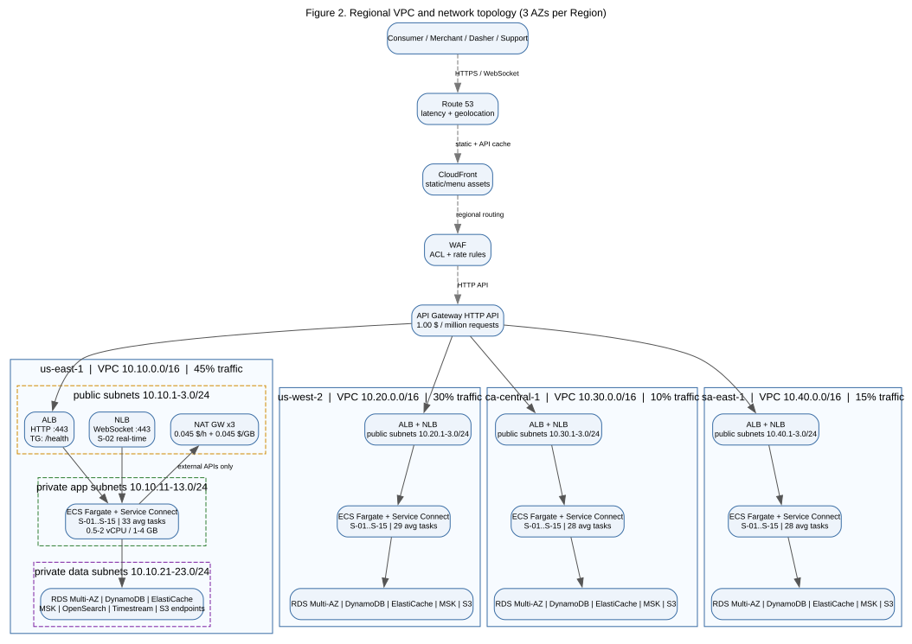
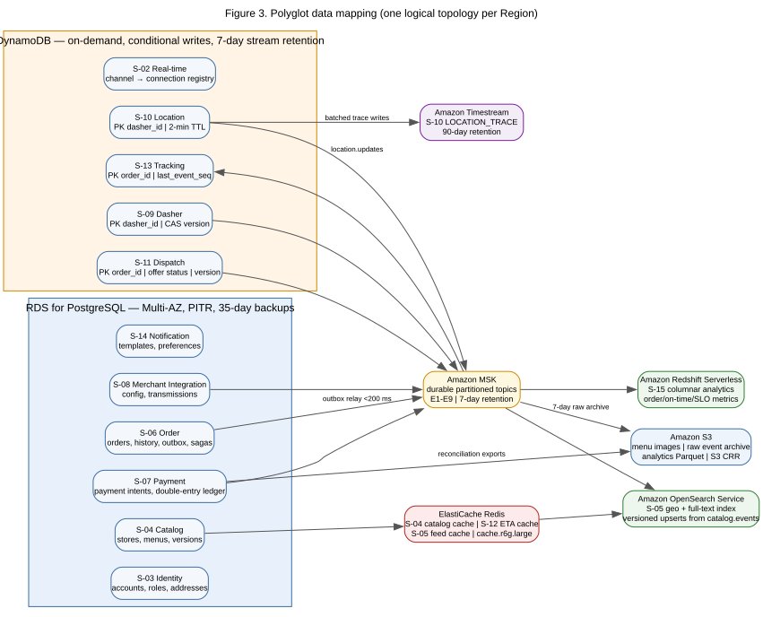
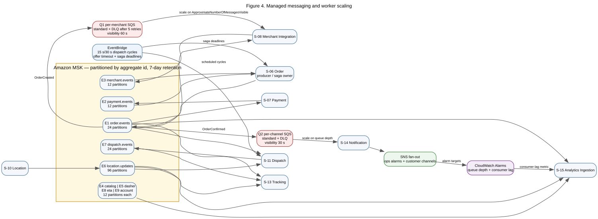
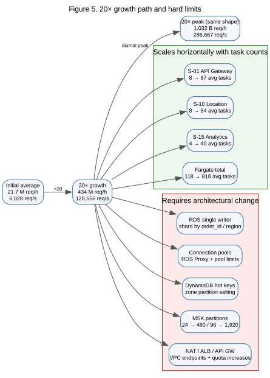

<section class="cover">

Universidad Distrital Francisco José de Caldas School of Engineering · Computer Engineering Program

Cloud Computing · Semester 2026-III

DoorDash — Food Delivery Platform

Delivery No. 3 — Cloud Architecture &amp; Scalability

Focus domain: Order Management, Route Optimization &amp; Notifications

<table>
<tr><td><b>Team</b></td><td>Team 2</td></tr>
<tr><td><b>Members</b></td><td>Daniel Felipe Barrera Suárez Jaider Camilo Carvajal Marín Nelson David Posso Suárez Edward Julián García Gaitán Julián David Cabrera Barragán</td></tr>
<tr><td><b>Professor</b></td><td>Eng. Carlos Andrés Sierra, M.Sc.</td></tr>
<tr><td><b>Date</b></td><td>November 2026</td></tr>
</table>

</section>

<!-- TOC -->

## 1. Executive Summary

Delivery 1 established the workload and the measurable conditions under which the platform must operate: **21.7 million requests/hour average**, **51.6 million requests/hour at peak**, **50,000 concurrent orders**, **185,000 peak users**, **8.5 TB launch data**, **54 TB/year growth**, **99.9 % availability**, eventual order-status convergence within five seconds, and regional data-residency obligations (NFR-01 – NFR-19) [1][2]. Delivery 2 translated those requirements into a cloud-independent architecture of **15 services** (S-01 – S-15), **10 ADRs**, service-owned polyglot stores, synchronous calls C1 – C12 and durable events E1 – E9 [3]. This document answers the Delivery 3 question: *how do we deploy and operate that software architecture on AWS under the specified load?*

The resulting cloud architecture is an **active-active, four-region deployment** on Amazon Web Services:

| Region | Traffic share | Role |
|---|---:|---|
| `us-east-1` | 45 % | North America East; primary control-plane and analytics aggregation |
| `us-west-2` | 30 % | North America West; independent regional cell |
| `ca-central-1` | 10 % | Canadian data residency and low-latency serving |
| `sa-east-1` | 15 % | Latin America; Colombia/Brazil data residency and regional dispatch |

Each Region is a self-contained cell with three Availability Zones, public subnets for API/load-balancer entry, private application subnets for ECS tasks and private data subnets for managed databases, caches and brokers. No request path depends synchronously on another Region. Route 53 performs latency- and health-based routing; CloudFront, AWS WAF and Amazon API Gateway protect the public edge; ECS on AWS Fargate runs every Delivery 2 service; Amazon RDS, DynamoDB, ElastiCache, OpenSearch, Timestream, S3 and Redshift implement the polyglot stores; Amazon MSK, SQS, SNS and EventBridge implement the communication architecture; CloudWatch and X-Ray provide observability; Cognito, IAM, Secrets Manager, KMS and VPC endpoints provide security controls.

The most important quantitative results are:

| Result | Value |
|---|---:|
| Services mapped to AWS resources | **15 / 15** |
| Average Fargate tasks across four Regions | **118** |
| Peak Fargate tasks across four Regions | **164** |
| D3 growth baseline (20 × D1 average) | **434 M req/h = 120,556 req/s** |
| Growth peak if the D1 daily shape persists | **1.032 B req/h = 286,667 req/s** |
| Average Fargate tasks at 20× | **818** |
| Peak Fargate tasks at 20× | **2,060** |
| Estimated AWS on-demand cost, initial | **$64,801 / month** |
| Estimated AWS on-demand cost, 20× | **$1,105,834 / month** |
| AZ-level RPO / RTO for orders and payments | **0 / ≤ 15 min** |

The growth analysis shows that compute scales horizontally with Fargate task counts, but four components do **not** scale by adding tasks alone: RDS single-writer primaries, connection-pool limits, DynamoDB hot partition keys and broker/network quotas. The plan therefore introduces sharding by `order_id` and `intent_id`, RDS Proxy, partition-key salting for zone state, 20× MSK partition counts, VPC endpoints and quota increases before those limits are reached.

Cost estimates use public on-demand list prices and the entry parameters reproducible in the AWS Pricing Calculator; the full arithmetic is in `cost/cost_model.csv`, `cost/capacity_model.csv` and `cost/pricing_sources.md`. Because calculator.aws has no public API, a saved share link or PDF export can only be produced through the browser UI; this report documents the same rates, quantities and assumptions instead of inventing a link.

## 2. Cloud Architecture Diagram

Figure 1 is the concrete AWS realization of Delivery 2. Every Delivery 2 service keeps its responsibility, API and data ownership; the AWS layer only supplies the execution environment and managed infrastructure. The diagram labels each component with the service name, instance/task tier and average-load count. The official AWS icons come from the AWS Architecture Icons package, release `07312026`; a local copy of the icons used is included in `diagrams/aws-icons/`.

### 2.1 Delivery 2 service → AWS resource mapping

| D2 ID | Service | AWS execution resource | Data / integration resources | Avg tasks | Peak tasks | 20× avg |
|---|---|---|---|---:|---:|---:|
| S-01 | API Gateway | API Gateway HTTP API + ECS Fargate BFF tasks behind ALB | WAF, CloudWatch, X-Ray | 8 | 13 | 87 |
| S-02 | Real-time Gateway | NLB + ECS Fargate WebSocket tasks | DynamoDB channel registry, ElastiCache presence cache | 12 | 24 | 200 |
| S-03 | Identity & Account | ECS Fargate | Cognito IdP, RDS PostgreSQL Multi-AZ | 8 | 8 | 8 |
| S-04 | Merchant Catalog | ECS Fargate | RDS PostgreSQL, ElastiCache, S3 images, OpenSearch feed source | 8 | 8 | 24 |
| S-05 | Search & Discovery | ECS Fargate | Amazon OpenSearch Service, ElastiCache feed cache | 8 | 11 | 64 |
| S-06 | Order | ECS Fargate | RDS PostgreSQL Multi-AZ, MSK `order.events`, EventBridge schedulers | 8 | 9 | 44 |
| S-07 | Payment | ECS Fargate | RDS PostgreSQL ledger, MSK `payment.events`, Secrets Manager | 8 | 8 | 14 |
| S-08 | Merchant Integration | ECS Fargate workers | SQS per-merchant queues + DLQ, Secrets Manager, POS endpoints | 8 | 8 | 24 |
| S-09 | Dasher | ECS Fargate | DynamoDB conditional writes, MSK `dasher.events` | 8 | 8 | 14 |
| S-10 | Location | ECS Fargate | DynamoDB latest positions, Timestream traces, MSK `location.updates` | 8 | 9 | 54 |
| S-11 | Dispatch | ECS Fargate zone-partition tasks | DynamoDB assignments, ElastiCache zone state, MSK + EventBridge | 9 | 17 | 100 |
| S-12 | Route & ETA | ECS Fargate | ElastiCache travel-time cache, S3 road graph, MSK `eta.events` | 9 | 17 | 93 |
| S-13 | Tracking | ECS Fargate | DynamoDB tracking views, MSK projections, S-02 push | 8 | 9 | 34 |
| S-14 | Notification | ECS Fargate workers | SQS per-channel queues, SNS fan-out, device-token store | 4 | 5 | 18 |
| S-15 | Analytics Ingestion | ECS Fargate workers | MSK consumers, S3 Parquet archive, Redshift Serverless | 4 | 10 | 40 |

Task counts are totals across the four regional cells and include the two-AZ minimum for core services. The full derivation is in Section 3.

### 2.2 Infrastructure components not present in Delivery 2

Delivery 2 was deliberately cloud-independent, so several AWS resources appear here for the first time. Each one is an infrastructure realization of an existing D2 capability, not a new business service.

| AWS resource | Why it appears | D2 component realized |
|---|---|---|
| Route 53 | Low-latency and health-based regional routing; NFR-18 | Public entry to S-01/S-02 |
| CloudFront + WAF | Static/menu asset offload and edge protection; NFR-06, security | S-01 edge responsibilities |
| ALB / NLB | Stable virtual IP, TLS and target groups for ECS | S-01 REST and S-02 WebSocket |
| NAT Gateway | Controlled egress to payment, POS, maps, push and identity providers | C12 external HTTPS |
| VPC endpoints | Private access to S3, ECR, CloudWatch, SQS, SNS, Secrets Manager | Cost and security optimization |
| AWS Backup | Centralized backup policy and cross-region copy | NFR-12/NFR-17 backup strategy |
| Redshift Serverless | Columnar analytical store | S-15 owned store |
| CloudTrail | Audit of control-plane and data-plane changes | Operations/security control |
| EventBridge Scheduler | Saga deadlines, 45 s offer expiry, 15–30 s dispatch cycles | S-06 saga and S-11 dispatch timers |

## 3. Compute Design

### 3.1 Sizing method

Every task count is derived from the Delivery 1 workload model and the Delivery 2 per-instance capacity assumptions. The base formula is:

`N = max(minimum, ceil(load / (capacity_per_task × 0.7)))`

- `load` is the service-specific arrival rate from Delivery 1, or the Delivery 2 planning load where D2 is more specific.
- `capacity_per_task` is the measured planning capacity from the D2 service catalog.
- `0.7` targets 70 % utilization, leaving headroom for garbage collection, bursts and rolling deployments.
- The regional floor is **2 tasks per core service per Region** (one in each of two AZs) and **1 task per non-critical service per Region** (S-14, S-15).
- Regional counts are computed from traffic share before summing, so the multi-region floor can raise totals above the single-global formula.

The D3 growth baseline follows the assignment literally: **initial workload = D1 average = 21.7 M req/h**, therefore **growth workload = 434 M req/h**. If the D1 daily shape is preserved, the corresponding growth peak is `51.6 M × 20 = 1.032 B req/h`. The D1 “2.9×” figure applies to order arrivals (75,000/26,000), while total request peak/average is 51.6/21.7 ≈ 2.38×; both are preserved rather than conflated.

### 3.2 Capacity model

The complete machine-readable model is in `cost/capacity_model.csv`. The table below is its report view.

| ID | Task size vCPU/GB | Driver unit | Capacity/task | Avg load | Peak load | Avg tasks | Peak tasks | 20× avg | 20× peak | Scaling metric |
|---|---:|---|---:|---:|---:|---:|---:|---:|---:|---|
| S-01 | 1 / 2 | req/s | 2,000 | 6,028 | 14,333 | 8 | 13 | 87 | 207 | ALB request count |
| S-02 | 2 / 4 | connections | 10,000 | 70,000 | 145,000 | 12 | 24 | 200 | 417 | open connections |
| S-03 | 0.5 / 1 | req/s | 300 | 44 | 125 | 8 | 8 | 8 | 14 | CPU + request count |
| S-04 | 0.5 / 1 | req/s | 500 | 380 | 1,100 | 8 | 8 | 24 | 65 | menu read rate |
| S-05 | 1 / 2 | queries/s | 200 | 430 | 1,040 | 8 | 11 | 64 | 150 | CPU + query rate |
| S-06 | 1 / 2 | ops/s | 150 | 220 | 520 | 8 | 9 | 44 | 100 | request + event ops |
| S-07 | 0.5 / 1 | req/s | 60 | 28 | 83 | 8 | 8 | 14 | 40 | CPU + request count |
| S-08 | 0.5 / 1 | msg/s | 100 | 72 | 208 | 8 | 8 | 24 | 60 | SQS visible messages |
| S-09 | 0.5 / 1 | req/s | 300 | 140 | 315 | 8 | 8 | 14 | 31 | CPU + request count |
| S-10 | 1 / 2 | writes/s | 2,500 | 4,528 | 10,000 | 8 | 9 | 54 | 117 | location write rate |
| S-11 | 2 / 4 | orders | 5,000 | 17,400 | 50,000 | 9 | 17 | 100 | 287 | zone orders + CPU |
| S-12 | 2 / 4 | req/s | 300 | 950 | 3,000 | 9 | 17 | 93 | 287 | CPU + computation rate |
| S-13 | 1 / 2 | req/s | 500 | 578 | 1,670 | 8 | 9 | 34 | 97 | read + event rate |
| S-14 | 0.5 / 1 | msg/s | 100 | 58 | 170 | 4 | 5 | 18 | 50 | SQS visible messages |
| S-15 | 1 / 2 | events/s | 3,000 | 4,000 | 14,300 | 4 | 10 | 40 | 138 | MSK consumer lag |

Worked examples:

- **S-01 at initial peak:** `ceil(14,333 / (2,000 × 0.7)) = ceil(10.24) = 11`; regional floors give 13 tasks.
- **S-10 at initial peak:** `ceil(10,000 / (2,500 × 0.7)) = ceil(5.71) = 6`; regional floors give 9 tasks.
- **S-01 at 20× average:** `ceil(120,556 / 1,400) = 87` tasks.
- **S-10 at 20× average:** `ceil(90,560 / 1,750) = 52`; regional floors give 54 tasks.
- **Fargate fleet:** 118 average and 164 peak tasks initially; 818 average and 2,060 peak tasks at 20×.

### 3.3 Auto-scaling policies

All services use ECS Service Connect for internal discovery and an internal ALB only where HTTP/2 RPC requires path-based routing. Scale-out is evaluated over 3 minutes; scale-in over 10 minutes to avoid oscillation during the rolling dinner peak. Cooldown is 300 s for request-driven services and 600 s for queue/broker consumers.

| Services | Scale-out trigger | Scale-in trigger | Cooldown | Notes |
|---|---|---|---:|---|
| S-01 | ALB `RequestCountPerTarget` > 1,400/s | < 700/s for 10 min | 300 s | 70 % of 2,000 req/s task capacity |
| S-02 | > 7,000 open connections/task | < 3,500/task | 300 s | NLB tracks per-target connections |
| S-03, S-07, S-09 | CPU > 60 % or requests > 70 % task capacity | CPU < 30 % and requests < 35 % | 300 s | Floors keep 2 tasks/Region |
| S-04 | menu reads > 350/s/task | < 175/s/task | 300 s | Cache reduces DB load |
| S-05 | CPU > 60 % or queries > 140/s/task | CPU < 30 % and queries < 70/s | 300 s | OpenSearch shards must scale with tasks |
| S-06 | ops > 105/s/task or saga lag > 500 | both < 50 % | 300 s | Outbox relay monitored separately |
| S-08 | `ApproximateNumberOfMessagesVisible` > 1,000/task | < 100/task for 10 min | 600 s | Per-merchant fairness preserved |
| S-10 | writes > 1,750/s/task | < 875/s/task | 300 s | Provisioned first for 20× (ADR-07) |
| S-11 | zone orders > 3,500/task or CPU > 65 % | < 1,750/task and CPU < 30 % | 300 s | Zone partitions rebalance on drain |
| S-12 | CPU > 60 % or computations > 210/s/task | both < 35 % | 300 s | External maps calls are cached |
| S-13 | reads + events > 350/s/task | < 175/s/task | 300 s | Tracking view in DynamoDB |
| S-14 | queue depth > 1,000/task | < 100/task | 600 s | Fallback channels have separate queues |
| S-15 | consumer lag > 10,000 events/task | < 1,000/task | 600 s | Lag from MSK `GetConsumerLag` custom metric |

### 3.4 Stateless versus stateful

- **Stateless:** S-01, S-03 – S-10, S-12 – S-15. No task-local business state is required; all durable state lives in managed stores. Tasks can be replaced independently.
- **Stateful per connection:** S-02 holds WebSocket connections in task memory, but the channel-to-connection registry is in DynamoDB/ElastiCache, so a lost task only drops its own connections and clients reconnect to any survivor.
- **Stateful per zone partition:** S-11 owns an in-memory optimisation cycle for a zone, but assignment records are in DynamoDB with conditional writes. On task loss, EventBridge and the zone service rebalance the partition and rebuild state from the store and events.

## 4. Networking Design

### 4.1 VPC and subnet plan

| Region | VPC CIDR | Public subnets | Private app subnets | Private data subnets |
|---|---|---|---|---|
| `us-east-1` | `10.10.0.0/16` | `10.10.1.0/24`, `10.10.2.0/24`, `10.10.3.0/24` | `10.10.11.0/24` – `10.10.13.0/24` | `10.10.21.0/24` – `10.10.23.0/24` |
| `us-west-2` | `10.20.0.0/16` | `10.20.1.0/24` – `10.20.3.0/24` | `10.20.11.0/24` – `10.20.13.0/24` | `10.20.21.0/24` – `10.20.23.0/24` |
| `ca-central-1` | `10.30.0.0/16` | `10.30.1.0/24` – `10.30.3.0/24` | `10.30.11.0/24` – `10.30.13.0/24` | `10.30.21.0/24` – `10.30.23.0/24` |
| `sa-east-1` | `10.40.0.0/16` | `10.40.1.0/24` – `10.40.3.0/24` | `10.40.11.0/24` – `10.40.13.0/24` | `10.40.21.0/24` – `10.40.23.0/24` |

CIDRs are non-overlapping so Transit Gateway peering can be added for analytics or disaster recovery without renumbering. Each Region uses three AZs. Application and data tiers have no route to an Internet Gateway; outbound traffic to external providers goes through NAT Gateways, while traffic to AWS services uses gateway/interface endpoints.

### 4.2 Load balancing

| Component | Placement | Listener / target group | Health check |
|---|---|---|---|
| API Gateway HTTP API | Regional, edge-optimized through CloudFront | HTTPS to public ALB | `GET /health` |
| Public ALB | One per Region, 3 public subnets | `:443` → target groups per public `/v1/*` service | `GET /health`, 10 s interval, 2 unhealthy threshold |
| Internal ALB | One per Region, app subnets | HTTP/2 `:8080` for C3 – C10 RPC | `GET /ready`, readiness includes DB/broker checks |
| NLB | One per Region, 3 public subnets | TCP `:443` → S-02 WebSocket tasks | TCP + `/live` application probe |

ALB sticky sessions are disabled except for the merchant tablet fallback channel; S-02 clients reconnect to any instance. Cross-zone load balancing is enabled. Connection draining is 30 s, matching the 45 s offer timeout budget.

### 4.3 Security groups and NACLs

| Tier | Ingress | Egress |
|---|---|---|
| Edge / ALB | `0.0.0.0/0:443`, `::/0:443` from CloudFront/WAF | Private app SG on service ports |
| S-02 NLB | `0.0.0.0/0:443` for WebSocket upgrade | S-02 task SG only |
| Application | Only ALB/internal ALB/NLB SG; Service Connect namespace | Data tier SG, MSK/SQS/SNS endpoints, NAT for external APIs |
| Data | Only application SG on DB/cache/broker ports | Required replication peers and S3 endpoints |
| NACL public | 443 in; ephemeral 1024–65535 out | 443 out; ephemeral in |
| NACL app | 8080/443 in from VPC CIDRs; ephemeral out | Data ports out; ephemeral in |
| NACL data | DB ports from app subnets only | Ephemeral responses |

NACLs are coarse stateless guards; security groups carry the fine-grained identity. All VPC flow logs go to CloudWatch Logs with 90-day retention.

### 4.4 Multi-AZ and regional resilience

Multi-AZ is the default for ALBs, NLBs, NAT Gateways, ECS services, RDS, ElastiCache, MSK and OpenSearch. A single-AZ component would be a conscious exception requiring a documented cost justification; none is used on the core order path. S-14 and S-15 are allowed one task per Region because events accumulate in durable queues during their recovery, satisfying NFR-11.

Region loss is handled by Route 53 health checks and region-local state. No service issues a synchronous cross-region call. Accepted orders are committed to a Multi-AZ primary before acknowledgement, which gives **RPO = 0 for an AZ failure** and aligns with NFR-12's “whole data-center” scenario. Cross-region replication is asynchronous for analytics and backup; a full Region failover targets **RTO ≤ 15 min** with an event-replication RPO of a few seconds, to be validated by Delivery 4 chaos tests.

## 5. Data Infrastructure

### 5.1 Managed service selection

| D2 store type | AWS service | Key configuration | Consistency boundary |
|---|---|---|---|
| Relational: Identity, Catalog, Order, Payment, Merchant, Notification | Amazon RDS for PostgreSQL | `db.m6g.large`, Multi-AZ, PITR 35 d, encrypted with KMS | ACID within one service aggregate |
| KV + CAS: Dasher, Assignment | Amazon DynamoDB | On-demand, conditional writes, 7-day streams | Linearizable single-key |
| Latest position / TTL | DynamoDB | PK `dasher_id`, TTL 120 s, GSI on `geo_cell` | Latest-writer-wins |
| Tracking view | DynamoDB | PK `order_id`, `last_event_seq` idempotency | Eventual, ≤ 5 s |
| Real-time channel registry | DynamoDB + ElastiCache | PK `channel_id`, SK `connection_id` | Best effort; rebuildable |
| Read cache / ETA cache | ElastiCache for Redis | `cache.r6g.large`, 2 nodes AZ-spread, `allkeys-lru` | Best effort, TTL-bounded |
| Search index | Amazon OpenSearch Service | `m6g.large.search`, 2 nodes, index by store/geography | Eventual from `catalog.events` |
| Location traces | Amazon Timestream | 90-day magnetic retention, batch writes | Eventual, append-only |
| Images, event archive, analytics Parquet | Amazon S3 | Standard → IA 30 d → Glacier 90/365 d, versioning, CRR | Durable object storage |
| Columnar analytics | Redshift Serverless | 1 RPU initial, 8 RPU at 20× | Minutes behind events |

Delivery 2 forbade cross-service database reads. That rule is preserved: each RDS database, DynamoDB table and OpenSearch index has one owning service; other services use APIs or events. Read replicas are used only inside the owning service where explicitly justified (Catalog and Order), never as another service's private copy.

### 5.2 RDS configuration

Six logical PostgreSQL clusters exist per Region: Identity, Catalog, Order, Payment, Merchant Integration and Notification. Each is Multi-AZ with automated backups, PITR and KMS encryption. The Order and Payment clusters use `RDS Proxy` to cap application connection counts and to survive failovers faster than direct ECS-to-RDS connections.

| Cluster | Initial instance | Read replicas | Backup / retention | Growth change |
|---|---|---:|---|---|
| Identity | `db.m6g.large` Multi-AZ | 0 | PITR 35 d, snapshot 7 y | 2 shards by region + id |
| Catalog | `db.m6g.large` Multi-AZ | 1/Region | PITR 35 d | 2 shards + 2 replicas/Region |
| Order | `db.m6g.large` Multi-AZ | 1/Region | PITR 35 d, archive 7 y | 4 shards by `hash(order_id)` + 4 replicas/Region |
| Payment | `db.m6g.large` Multi-AZ | 0 | PITR 35 d, ledger archive 7 y | 4 shards by `hash(intent_id)` |
| Merchant Integration | `db.m6g.large` Multi-AZ | 0 | PITR 35 d | 2 shards by `store_id` |
| Notification | `db.m6g.large` Multi-AZ | 0 | PITR 35 d | 2 shards by `recipient_id` |

At 20×, 24 logical Multi-AZ clusters become 96 sharded clusters with 32 read replicas. Read replicas alone are insufficient because Order and Payment are write-heavy aggregates; sharding is mandatory.

### 5.3 DynamoDB table design

| Table | Partition key | Sort key / attributes | GSI | Capacity / TTL |
|---|---|---|---|---|
| `dasher_state` | `dasher_id` | `version`, `state`, `zone_id`, `active_assignments` | `gsi_zone_state(zone_id, state)` | On-demand; CAS on `version` |
| `assignment` | `order_id` | `dasher_id`, `offer_status`, `batch_id`, `version` | `gsi_dasher(dasher_id)` | On-demand; conditional write |
| `latest_position` | `dasher_id` | `lat`, `lng`, `seen_at`, `geo_cell` | `gsi_geo_cell(geo_cell)` | On-demand; TTL 120 s |
| `tracking_view` | `order_id` | `status`, `eta`, `position`, `last_event_seq` | none | On-demand; TTL 1 h after delivery |
| `channel_registry` | `channel_id` | `connection_id`, `task_id`, `expires_at` | `gsi_task(task_id)` | On-demand; TTL 24 h |

DynamoDB adaptive capacity handles most uneven traffic, but Dispatch zone keys can become hot at 20×. The mitigation is partition-key salting (`zone_id#slot`) with a deterministic slot from `hash(order_id) mod 16`, preserving per-order ordering while distributing hot zones.

### 5.4 S3, backup and retention

| Bucket | Content | Class / lifecycle | Replication |
|---|---|---|---|
| `dd-menu-images-{region}` | Merchant images | Standard → IA after 30 d | CRR to backup Region |
| `dd-events-raw-{region}` | Raw E1 – E9 archive | Standard 7 d → Glacier IR 7 y | CRR to analytics Region |
| `dd-gps-trace-{region}` | Parquet GPS traces beyond Timestream | Standard 30 d → Glacier 90 d | None; recomputable |
| `dd-analytics-{region}` | Curated S-15 Parquet | Standard → IA 90 d | CRR to `us-east-1` |
| `dd-backups-{region}` | RDS snapshots, config exports | Standard → Glacier Deep Archive 7 y | CRR |

AWS Backup runs daily RDS and DynamoDB backups with 35-day PITR and 7-year financial snapshots. KMS customer-managed keys encrypt every bucket and database; TLS 1.2+ is required by bucket policy and RDS parameter groups.

## 6. Communication Infrastructure

### 6.1 Event backbone on Amazon MSK

Delivery 2 requires durable, partitioned, replayable topics with aggregate-id ordering and at-least-once delivery. Amazon SNS/SQS alone cannot provide seven-day replay or per-aggregate partition order, so the E1 – E9 backbone is implemented with Amazon MSK. SNS and SQS are still used for fan-out, work queues and alarms where their semantics fit.

| Topic | D2 ID | Key | Initial partitions | 20× partitions | Retention | Replication |
|---|---|---|---:|---:|---:|---:|
| `order.events` | E1 | `order_id` | 24 | 480 | 7 d | 3 |
| `payment.events` | E2 | `intent_id` | 12 | 240 | 7 d | 3 |
| `merchant.events` | E3 | `order_id` | 12 | 240 | 7 d | 3 |
| `catalog.events` | E4 | `store_id` | 6 | 120 | 7 d | 3 |
| `dasher.events` | E5 | `dasher_id` | 12 | 240 | 7 d | 3 |
| `location.updates` | E6 | `dasher_id` | 96 | 1,920 | 7 d | 3 |
| `dispatch.events` | E7 | `order_id` | 24 | 480 | 7 d | 3 |
| `eta.events` | E8 | `zone_id` | 12 | 240 | 7 d | 3 |
| `account.events` | E9 | `account_id` | 6 | 120 | 7 d | 3 |

Three `kafka.m5.large` brokers per Region form the initial MSK cluster; 12 per Region at 20×. Consumers store `(aggregate_id, sequence)` in their own DynamoDB/RDS store to make at-least-once events effectively once. Transactional outbox relays in S-06, S-07, S-08, S-09 and S-11 publish to MSK with a target lag under 200 ms.

### 6.2 Queues, fan-out and schedulers

| Resource | Configuration | Purpose |
|---|---|---|
| Q1 per-merchant SQS | Standard, visibility 60 s, retention 14 d, DLQ after 5 receives | Buffers POS calls and enforces 300 req/60 s with a token bucket |
| Q2 per-channel SQS | Standard, visibility 30 s, retention 14 d, DLQ after 5 receives | Push/SMS/e-mail fallback without blocking order state |
| SNS customer topics | FIFO not required; published after preference resolution | Fan-out to S-02 in-app, push provider and SMS fallback |
| SNS ops topics | `dd-ops-critical`, `dd-ops-warning`, `dd-ops-ml` | CloudWatch alarm targets and on-call paging |
| EventBridge rules | Scheduled 15 s/30 s dispatch cycles, 45 s offer expiry, saga deadlines | Replaces in-process timers without holding ECS tasks |
| SQS redrive | DLQ retained 14 d, replayed by support tooling | No order loss during provider outages |

### 6.3 Worker scaling

S-08, S-14 and S-15 scale on `ApproximateNumberOfMessagesVisible` per task (threshold 1,000; scale-in below 100). MSK consumers use a custom `consumer_lag` metric exported to CloudWatch every 30 s; S-15 scales when lag exceeds 10,000 events per task. S-10 writes are provisioned first, as required by ADR-07, because telemetry is 73 % of all writes.

### 6.4 Synchronous calls C1 – C12

Synchronous calls remain inside a Region and use ECS Service Connect or the internal ALB. Delivery 2's text is inconsistent about the number of internal synchronous calls (it says “six” in the summary/ADR-02 but lists C1 – C12); this document uses the explicit C1 – C12 list because it is the authoritative matrix.

| ID | Call | AWS path |
|---|---|---|
| C1 | Client → S-01 | Route 53 → CloudFront/WAF → API Gateway → ALB |
| C2 | S-01 → domain services | Internal ALB / Service Connect |
| C3 | S-06 → S-04 `ValidateCart` | Service Connect |
| C4 | S-06 → S-12 `QuoteWindow` | Service Connect |
| C5 | S-06 → S-07 `Authorize` | Service Connect, 2 s timeout |
| C6 | S-05 → S-12 `ZoneEstimates` | Service Connect, cached |
| C7 | S-11 → S-12 `TravelTimeMatrix` | Service Connect |
| C8 | S-11 → S-10 `NearbyDashers` | Service Connect |
| C9 | S-11 → S-09 `ReserveDasher` | Service Connect, DynamoDB CAS |
| C10 | S-08 → S-04 `UpsertMenu` | Service Connect |
| C11 | S-13/S-14/S-08 → S-02 | NLB + in-region channel registry |
| C12 | S-07/S-08/S-12/S-14 → external providers | NAT Gateway → HTTPS provider API |

Every call uses timeouts, one bounded retry and circuit breakers; external calls additionally use Secrets Manager credentials and WAF/ALB egress controls.

## 7. Operations Plan

### 7.1 Logging

Each ECS service writes structured JSON to its own CloudWatch log group: `/aws/ecs/dd/{region}/{service}`. Application logs are retained 30 days; audit and security logs 90 days; CloudTrail 1 year. Every record contains `timestamp`, `level`, `service`, `region`, `trace_id`, `span_id`, and one correlation identifier (`order_id`, `dasher_id`, `store_id` or `channel_id`). High-cardinality identifiers are not promoted to CloudWatch metrics.

### 7.2 Metrics, dashboards and alarms

| Signal | Metric source | Alarm condition | Action |
|---|---|---|---|
| API latency | ALB `TargetResponseTime` p95/p99 | p95 > NFR target for 5 min | SNS → on-call |
| Error rate | ALB/API Gateway `HTTPCode_Target_5XX_Count` | > 1 % for 5 min | SNS → on-call |
| Saturation | ECS CPU/Memory, ALB `RequestCountPerTarget` | > 70 % target for 5 min | ECS scale-out |
| Queue depth | SQS `ApproximateNumberOfMessagesVisible` | > 1,000/task for 3 min | Worker scale-out |
| Consumer lag | MSK custom `consumer_lag` | > 10,000/task for 3 min | Analytics scale-out |
| Database health | RDS CPU, connections, replica lag | CPU > 70 %, lag > 5 s | SNS + RDS Proxy review |
| Order convergence | `order_status_lag_seconds` custom metric | p95 > 5 s (NFR-13) | SNS → critical |
| Notification delivery | `event_to_notify_seconds` custom metric | p95 > 5 s (FR-12) | SNS → warning |
| On-time SLA | Redshift `on_time_rate_1h` | < 95 % (NFR-14) | SNS → operations |

Four CloudWatch dashboards are provided: **edge**, **order lifecycle**, **logistics/telemetry** and **data/platform**. Each shows latency, errors, throughput and saturation for its services, plus the NFR targets from Delivery 1.

### 7.3 Health checks and tracing

- ALB target groups call `GET /health`; ECS readiness probes call `GET /ready` and include dependency checks for the service's own store and broker. Liveness probes call `GET /live` and do not check dependencies, preventing restart cascades.
- X-Ray is enabled on ECS, ALB, API Gateway and Lambda. A 5 % sample is recorded, with 100 % sampling for requests carrying `x-debug: true`. `trace_id` is propagated through HTTP headers and MSK event headers.
- Deployments use ECS rolling updates with 25 % minimum healthy percent and 200 % maximum percent. S-02 drains connections before task replacement.

## 8. Security Design

### 8.1 Authentication and authorization

The token flow preserves Delivery 2's S-03 ownership of identity while using managed AWS primitives:

1. A user authenticates with Amazon Cognito (consumer, merchant staff, Dasher or support pool).
2. S-03 exchanges the Cognito assertion for a short-lived platform JWT containing `sub`, `roles`, `region`, `permission_version` and `exp`.
3. API Gateway uses a Lambda authorizer with a cached JWKS to verify the signature locally; no per-request call to S-03 is made, matching D2 S-01.
4. S-02 validates the same JWT on WebSocket upgrade and authorizes channel subscriptions against `order:{id}`, `dasher:{id}` and `store:{id}`.
5. Internal service calls use task IAM roles and short-lived signed headers; security groups restrict which task roles may call which ports.

Authorization is least privilege: one IAM role per ECS task definition, scoped to the exact DynamoDB tables, S3 buckets, SQS queues and Secrets Manager secrets that service owns. Cross-account access is not used.

### 8.2 Secrets, network and data protection

- Database credentials, POS tokens, payment-processor keys and map API keys are stored in Secrets Manager with 30-day rotation where supported; non-secret feature flags use Parameter Store.
- WAF rules block known malicious IPs, enforce rate limits per client/IP and apply size constraints to JSON bodies. WAF is attached to API Gateway and the public ALB.
- VPC endpoints provide private access to S3, ECR, CloudWatch Logs, SQS, SNS, EventBridge, Secrets Manager and STS. Only external provider APIs traverse NAT Gateways.
- KMS customer-managed keys encrypt RDS, DynamoDB, ElastiCache, MSK broker storage, S3, CloudWatch Logs and Secrets Manager. All network traffic uses TLS 1.2+; internal HTTP/2 uses TLS through Service Connect.
- CloudTrail records all control-plane activity; GuardDuty monitors VPC flow logs; AWS Config checks encryption and public-access rules continuously.
- Card data never enters the platform; the processor tokenizes it, as required by Delivery 1. Colombian customer data is processed in `sa-east-1` under controls mapped to Ley 1581/2012 [1].

## 9. Growth Scenario Analysis

### 9.1 Baseline and headline changes

| Metric | Initial | 20× growth |
|---|---:|---:|
| Average requests/hour | 21.7 M | 434 M |
| Average requests/second | 6,028 | 120,556 |
| Peak requests/hour | 51.6 M | 1.032 B |
| Peak requests/second | 14,333 | 286,667 |
| Orders/hour (peak) | 75,000 | 1.5 M |
| Concurrent orders | 50,000 | 1.0 M |
| GPS reports/hour | 36 M | 720 M |
| Concurrent users | 185,000 | 3.7 M |
| Launch data | 8.5 TB | 170 TB |
| Annual growth | 54 TB/year | ≈ 1.08 PB/year |
| Average Fargate tasks | 118 | 818 |
| Peak Fargate tasks | 164 | 2,060 |

### 9.2 Compute

Compute is the least problematic dimension. Adding Fargate tasks handles the 6.8× increase in average task count (118 → 818) and the 12.6× increase in peak task count (164 → 2,060). The largest growth is S-01 (8 → 87 avg), S-02 (12 → 200 avg), S-10 (8 → 54 avg), S-11 (9 → 100 avg) and S-15 (4 → 40 avg). No instance-family change is required because the per-task capacities are unchanged; the task sizes already reserve headroom through 70 % utilization.

Bottlenecks that horizontal scaling alone does not solve:

- ECS service quota and ENI/IP exhaustion per subnet. Mitigation: raise ECS/ENI quotas, expand app subnets to `/20` and use prefix delegation.
- API Gateway and ALB request/LCU quotas. Mitigation: quota increase requests, additional ALBs per Region and CloudFront caching for read-heavy endpoints.
- S-02 WebSocket connection limits. Mitigation: 417 peak tasks, NLB quota increase and client reconnect jitter.

### 9.3 Databases

Read replicas alone are not sufficient at 20×:

- **RDS:** six logical clusters per Region are sharded 4×, giving 24 sharded Multi-AZ clusters per Region. Order uses `hash(order_id)`, Payment uses `hash(intent_id)`, Catalog uses `hash(store_id)`, Identity uses region + `hash(account_id)`. RDS Proxy caps connections at 70 % of each shard's `max_connections`.
- **DynamoDB:** on-demand mode absorbs bursty telemetry, but hot zone keys are salted with 16 slots. Assignment and Dasher records remain single-key linearizable.
- **ElastiCache:** 2 → 8 nodes per cluster; client-side consistent hashing and TTLs prevent cache stampede.
- **OpenSearch:** 2 → 8 data nodes per Region; index shards are pre-split by region and date to avoid resharding during peak.
- **Timestream:** 16.3 M → 326 M GPS writes/hour at average growth; writes are batched and raw points beyond 90 days are archived to S3 Parquet.
- **Redshift Serverless:** 1 → 8 RPU with workload management queues separating operational SLO queries from ad-hoc analytics.

### 9.4 Networking

At 20× the dominant network risks are connection counts and NAT throughput, not raw bandwidth:

- 3.7 M concurrent users and 720 M GPS reports/hour require NLB quota increases and 417 S-02 tasks.
- NAT Gateways are a shared 45 Gbps-per-AZ service limit in principle, but the real risk is per-AZ connection tracking. All AWS-service traffic is moved to gateway/interface endpoints; only external providers use NAT.
- Cross-region replication is limited to aggregated analytics and backups. Order, payment and assignment writes remain region-local, avoiding cross-region RTT on the critical path.
- CloudFront absorbs static and menu-image traffic; API Gateway cache and ElastiCache reduce origin calls.

### 9.5 Messaging

MSK partitions increase by 20× (for example `location.updates` 96 → 1,920). Broker count increases from 3 to 12 per Region, and broker storage from 3 TB to 60 TB. Consumer groups are rebalanced with cooperative sticky assignment to avoid stop-the-world rebalances. SQS retains standard queues because ordering is enforced by aggregate keys and idempotency, not FIFO; per-merchant token buckets remain the rate-control point.

### 9.6 Cost

Monthly on-demand cost grows from **$64,801** to **$1,105,834**, a factor of about **17×**. Cost growth is lower than workload growth because some components (NAT Gateways, WAF ACLs, KMS keys, Route 53) are fixed or sub-linearly scaled. The largest growth drivers are DynamoDB writes, Timestream writes, RDS shards and CloudWatch log ingestion. Savings Plans, Reserved Instances and storage lifecycle policies should be applied before production, but they are excluded from this on-demand baseline.

## 10. Cost Analysis

The estimates below use public AWS on-demand list prices with the quantities and usage assumptions documented in `cost/pricing_sources.md`; the machine-readable source is `cost/cost_model.csv`. Prices were accessed on **2026-11-22** from the AWS Pricing Calculator at https://calculator.aws/ and the linked AWS price pages.

| Category | Initial ($/month) | 20× Growth ($/month) |
|---|---:|---:|
| Compute (ECS/EKS/EC2) — ECS Fargate | 4,872 | 49,740 |
| Databases (RDS/DynamoDB/Timestream/OpenSearch/Redshift) | 30,761 | 559,373 |
| Caching (ElastiCache) | 2,733 | 10,932 |
| Storage (S3) | 1,472 | 29,440 |
| Networking (data transfer, NAT) | 761 | 5,224 |
| Messaging (SQS/SNS/EventBridge/MSK) | 8,707 | 144,710 |
| Monitoring (CloudWatch) | 12,018 | 240,356 |
| Security (WAF, Secrets Manager) | 3,477 | 66,058 |
| **Total** | **64,801** | **1,105,834** |

### 10.1 Cost assumptions

- Effective billed Fargate tasks = `average + 0.125 × (peak − average)`, representing the 3-hour dinner peak.
- RDS: 24 Multi-AZ `db.m6g.large` clusters initially; 96 `db.m6g.2xlarge` shards plus 32 replicas at growth.
- DynamoDB: on-demand WCU/RCU from D1 location and request rates; storage 2.4 TB initially and 48 TB at growth.
- S3: 8.5 TB launch data + 54 TB/year operational archive; 20× at growth.
- Networking: 12 NAT Gateways, 80 % egress offloaded to CloudFront, 10 KB mean response.
- Messaging: 21.7 M events/hour baseline through SQS-equivalent request pricing, plus 12 MSK brokers and 3 TB storage at growth.
- Monitoring: 1 KB structured log per request, 5 % X-Ray sampling, 150 metrics and 60 alarms.
- Security: 4 WAF ACLs, 40 rules, 40 secrets and 50 KMS keys.

### 10.2 Interpretation

The baseline is dominated by databases (47 %) and monitoring (19 %), reflecting the write-heavy telemetry workload and the need to retain audit data. At 20×, databases rise to 51 % of total cost, primarily DynamoDB and Timestream writes plus RDS shards. The most effective optimizations are: sample raw GPS points before persistence, move cold traces to S3 Glacier earlier, use Savings Plans for the stable Fargate/RDS baseline, and enable S3 Intelligent-Tiering for analytics data. These are deliberately excluded from the on-demand figures so the estimate remains transparent and reproducible.

## 11. Traceability and Delivery 2 Coverage

| Requirement / decision | Cloud mechanism |
|---|---|
| NFR-03/04 throughput | Fargate auto-scaling, MSK partitioning, DynamoDB on-demand |
| NFR-05 bursts | 70 % utilization target, SQS/MSK buffering, 2×/15 min headroom |
| NFR-06/08 latency | CloudFront, ElastiCache, OpenSearch/DynamoDB read models |
| NFR-07 checkout | C3 – C5 kept in-region; RDS Proxy and 2 s payment timeout |
| NFR-09 tracking latency | Timestream + DynamoDB + S-02 NLB push |
| NFR-10 dispatch | EventBridge cycles, zone-partition ECS tasks, DynamoDB CAS |
| NFR-11 availability | Multi-AZ default, 2 core tasks/Region, non-critical consumers lag safely |
| NFR-12 RPO/RTO | Multi-AZ RPO 0, PITR 35 d, AWS Backup, region RTO ≤ 15 min |
| NFR-13 consistency | DynamoDB conditional writes, idempotent MSK consumers, outbox |
| NFR-15 merchant limits | SQS Q1 + token bucket + DLQ |
| NFR-17 data growth | S3 lifecycle, Timestream TTL, Redshift Serverless |
| NFR-18 geography | Four regions, Route 53 latency routing, 3 AZs each |
| NFR-19 residency | Region-pinned order/account data; no cross-region synchronous dependency |
| ADR-01 microservices | One ECS task family per D2 service |
| ADR-02 event-driven | MSK + SQS + SNS + EventBridge |
| ADR-03 saga | S-06 ECS tasks + EventBridge deadlines + MSK compensations |
| ADR-04 polyglot | RDS, DynamoDB, ElastiCache, OpenSearch, Timestream, S3, Redshift |
| ADR-05 outbox | RDS outbox table + MSK relay |
| ADR-06 CQRS | OpenSearch and DynamoDB projections |
| ADR-07 telemetry first | S-10 capacity provisioned before other 20× services |
| ADR-08 payment split | Sync authorize, async capture/refund via MSK |
| ADR-09 merchant queues | Q1 SQS + token bucket + DLQ |
| ADR-10 push + polling fallback | NLB WebSocket tasks + 10 s polling via API Gateway |

## 12. References

[1] Team 2, *DoorDash — Requirements & Workload Specification*, Delivery 1, 2026.  
[2] DoorDash public filings and engineering blog, cited in Delivery 1 §5 and §7.  
[3] Team 2, *DoorDash — Software Architecture Document*, Delivery 2, 2026.  
[4] Universidad Distrital Francisco José de Caldas, *Cloud Computing — Delivery No. 3: Cloud Architecture & Scalability*, 2026.  
[5] Amazon Web Services, *AWS Pricing Calculator*, https://calculator.aws/, accessed 2026-11-22.  
[6] Amazon Web Services, *AWS Architecture Icons*, https://aws.amazon.com/architecture/icons, accessed 2026-11-22.  
[7] Amazon Web Services, *AWS Pricing Calculator User Guide — Exporting estimates*, https://docs.aws.amazon.com/pricing-calculator/latest/userguide/export-estimate.html, accessed 2026-11-22.
